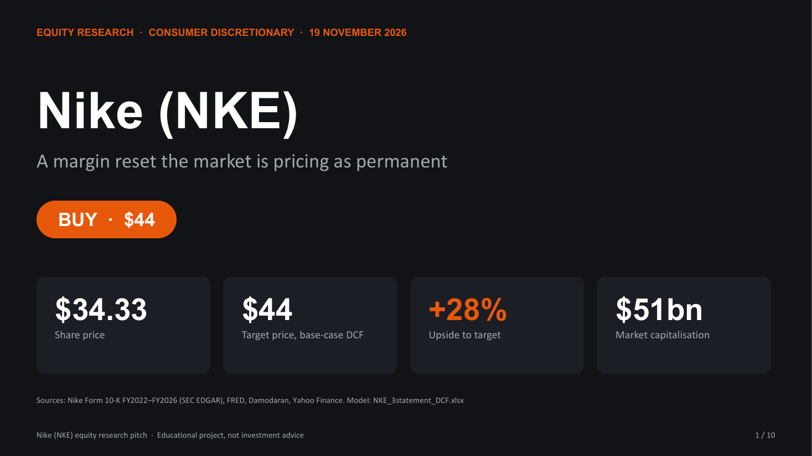
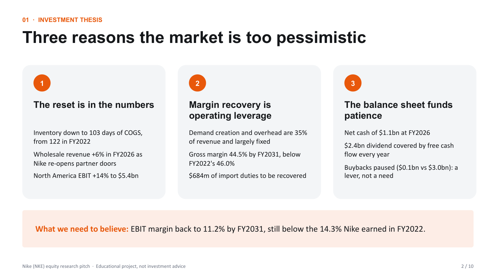
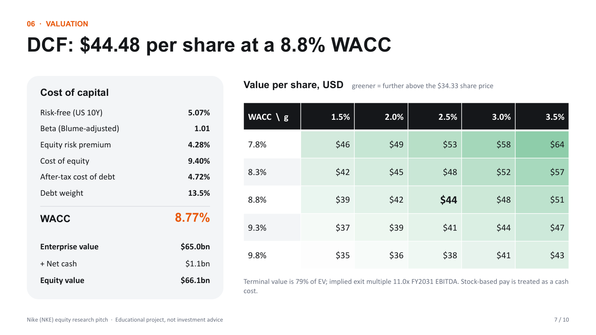
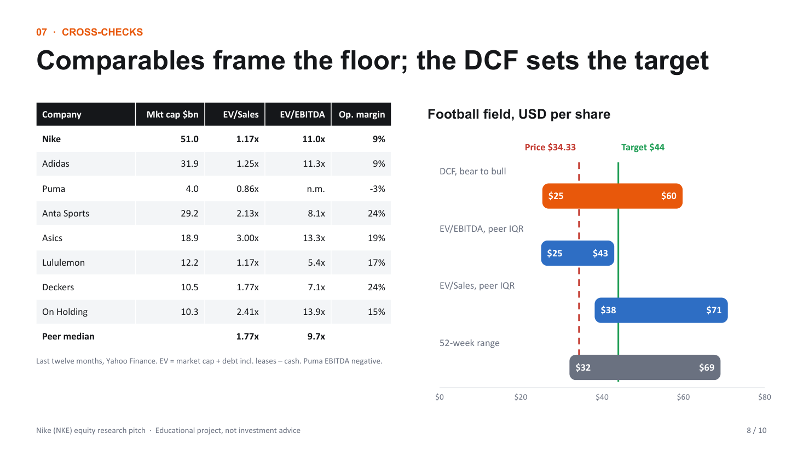
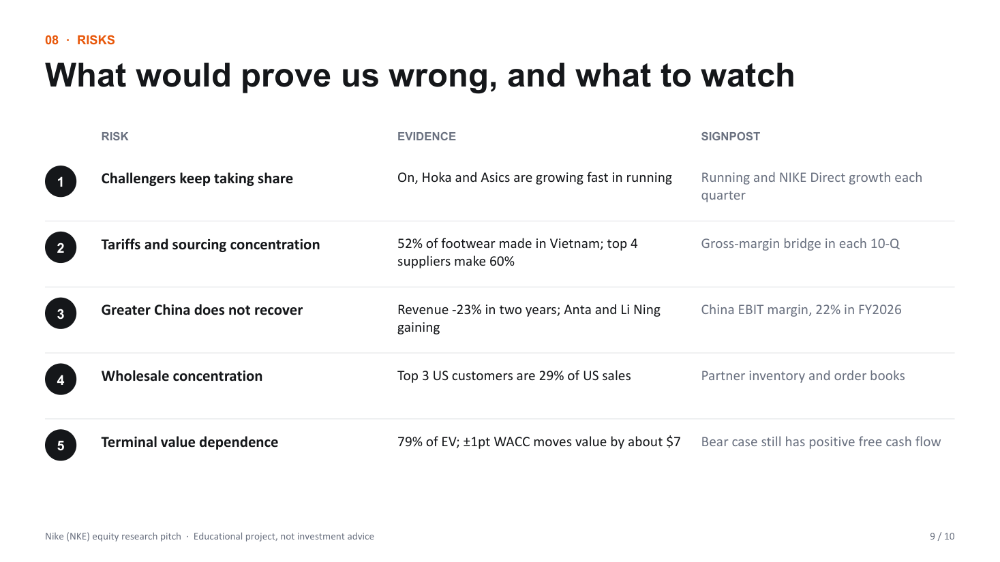
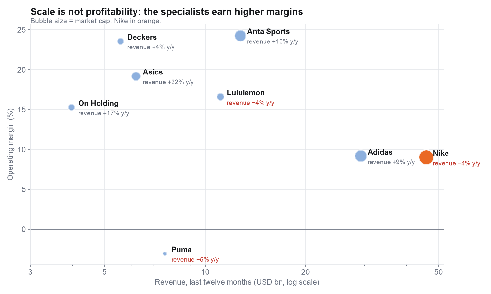

# Nike (NKE) equity research: 3-statement model, DCF, stock pitch and industry deep dive

[](https://github.com/dmp009/nke-equity-research/actions/workflows/ci.yml)

This repository contains a complete sell-side style piece of work on **Nike, Inc.**, built from
the company's SEC filings. It has three parts:

| # | Deliverable | File | Result |
|---|---|---|---|
| 1 | **3-statement model + DCF** (income statement, balance sheet, cash flow, all linked, with live Excel formulas) | [`outputs/NKE_3statement_DCF.xlsx`](outputs/NKE_3statement_DCF.xlsx) | Enterprise value **USD 65.0bn**, value per share **USD 44.48** (base case) |
| 2 | **10-slide stock pitch**: an equity analyst pitching to a portfolio manager | [`outputs/NKE_stock_pitch.pdf`](outputs/NKE_stock_pitch.pdf) ([.pptx](outputs/NKE_stock_pitch.pptx)) | **BUY, target USD 44** vs USD 34.33 share price (+28%) |
| 3 | **Industry deep dive**: global athletic footwear and apparel | [`docs/industry_deep_dive.md`](docs/industry_deep_dive.md) | Value chain, 8 players, Porter's five forces, regulation, where the money is made |

*Educational project, not investment advice. Prices as of 19 November 2026.*



## 1. Three-statement model and DCF

- **Data.** Five years of history (FY2022–FY2026, fiscal years end 31 May) come straight from Nike's
  10-K filings through the **SEC EDGAR XBRL API**. Every historical line ties to the reported
  totals, and a test checks this.
- **Forecast.** Five years (FY2027E–FY2031E), driven by the blue input cells on the `Inputs`
  sheet. Cell `Inputs!C4` switches between **bear, base and bull** scenarios, and every statement,
  the DCF and the sensitivity grid recalculate.
- **Linking.** Net income flows to equity. D&A, capex and working-capital changes flow to the cash
  flow statement, and its ending cash becomes balance-sheet cash. **The balance sheet balances in
  all 10 years.** Interest is computed on prior-year balances, so there is no circular reference.
- **DCF.** FCFF discounted at a **WACC of 8.77%**:
  - risk-free rate: US 10-year Treasury (FRED), 5.07%;
  - beta: regression on two years of weekly returns, Blume-adjusted, 1.01;
  - equity risk premium: Damodaran implied ERP, 4.28%.

  The terminal value uses the Gordon growth model at 2.5%. The model also includes a stub period
  for the part of FY2027 already elapsed, a WACC × growth sensitivity grid and an implied exit
  multiple cross-check.
- **Verified.** The Excel workbook is recalculated with the `formulas` engine and must give the
  same value per share as an independent Python implementation (`nkeresearch/model.py`), to
  machine precision (`tests/test_excel_ties.py`).

| Scenario | Revenue CAGR FY26–31 | EBIT margin FY2031 | Value / share | vs price |
|---|---:|---:|---:|---:|
| Bear | 0.6% | 7.0% | USD 25.30 | −26% |
| **Base** | **3.0%** | **11.2%** | **USD 44.48** | **+30%** |
| Bull | 5.2% | 13.8% | USD 59.81 | +74% |

Every assumption, with its source and the argument for it, is in
[`docs/assumptions.md`](docs/assumptions.md).

## 2. Stock pitch (10 slides)

Title and recommendation, investment thesis, company overview, what went wrong, catalysts and
what we need to believe, base-case forecast, DCF and sensitivity, comps and football field, risks
with signposts, and the final recommendation.

The deck is a native PowerPoint file generated by `nkeresearch/deck.py` (python-pptx): the charts
are editable PowerPoint charts with their data inside, the tables are real tables, and every slide
has speaker notes with the pitch script. The PDF and the previews below are exported from
PowerPoint (`make pdf`, macOS).

| | |
|---|---|
|  |  |
|  |  |

**The thesis in one line:** the market prices Nike's FY2026 EBIT margin of 8.2% as permanent. A
partial recovery to 11.2% by FY2031, still below the 14.3% of FY2022, is worth USD 44 a share.

## 3. Industry deep dive

[`docs/industry_deep_dive.md`](docs/industry_deep_dive.md) covers:

- the value chain (materials → contract manufacturers → brands → wholesale or direct to consumer);
- 8 listed players with combined revenue of USD 122bn;
- Porter's five forces;
- regulation (tariffs, forced-labour laws, EU sustainability reporting);
- trends, and what they mean for the Nike call.



## How it works

```
SEC EDGAR XBRL (10-K) ──► nkeresearch/sec.py ──┐
FRED, yfinance ──────────► nkeresearch/market.py ┤ (snapshots committed in data/)
                                                 ▼
                          nkeresearch/model.py  (3 statements + DCF, reference)
                          nkeresearch/excel.py  (same model as live Excel formulas)
                          nkeresearch/deck.py   (10-slide pitch, native PPTX)
                          nkeresearch/industry.py (deep-dive charts)
```

```bash
python3.11 -m venv .venv && .venv/bin/pip install -r requirements.txt
make build     # rebuild every output from the committed snapshots (no network)
make test-all  # 19 tests: statements tie to the 10-K, balance sheet balances, Excel = Python, quoted facts appear in the 10-K
make pdf       # optional, macOS + PowerPoint: export the deck to PDF and PNG previews
make data      # optional: refresh the SEC and market data (network)
```

## Limitations

- Market multiples come from Yahoo Finance and are trailing twelve months. Revenue growth is the
  latest quarter, year on year.
- The model is consolidated. Segments are used in the pitch and the deep dive, but they are not
  forecast separately.
- Debt is held flat (maturities refinanced), and operating leases stay in operating costs, as
  US GAAP presents them.

## How to describe this project on a CV

- *Built a linked 3-statement model and DCF for Nike from SEC EDGAR 10-K data. The base case gives
  a USD 65.0bn enterprise value and a USD 44 target price; the Excel model is verified against an
  independent Python implementation.*
- *Wrote a 10-slide BUY pitch on Nike with bear/base/bull values of USD 25/44/60, an 8.8% WACC and
  a 7-peer comparables cross-check.*
- *Produced an industry deep dive on global athletic footwear and apparel: value chain, Porter's
  five forces and regulation across 8 listed players with USD 122bn of revenue.*

---

## Résumé en français

Ce dépôt présente une analyse complète de **Nike, Inc.** en trois livrables, construite à partir
des rapports annuels 10-K publiés sur SEC EDGAR :

1. **Un modèle à trois états financiers relié** (compte de résultat, bilan, flux de trésorerie) et
   une **valorisation DCF** dans Excel avec des formules vivantes. Le bilan est équilibré sur les
   10 années. Le modèle comporte trois scénarios (pessimiste, central, optimiste), un CMPC de
   8,77 % et une table de sensibilité. La valeur d'entreprise ressort à 65,0 Md USD et la valeur
   par action à 44,48 USD dans le scénario central. Le classeur Excel est vérifié contre une
   implémentation Python indépendante.
2. **Un pitch d'investissement de 10 diapositives** : recommandation **ACHAT**, objectif de cours
   44 USD contre un cours de 34,33 USD (+28 %), avec la thèse, les catalyseurs, les comparables
   boursiers et les risques.
3. **Une étude sectorielle** sur les chaussures et vêtements de sport (chaîne de valeur,
   8 acteurs cotés, cinq forces de Porter, réglementation). La valeur se crée chez les marques,
   et la faible marge actuelle de Nike reflète un problème d'exécution plutôt qu'un plafond du
   secteur.

*Projet pédagogique, pas un conseil en investissement.*

## License

MIT
