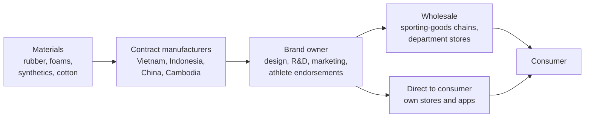
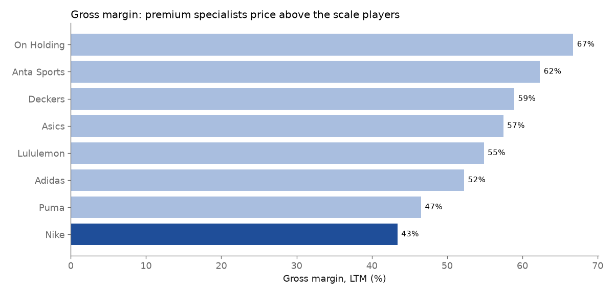
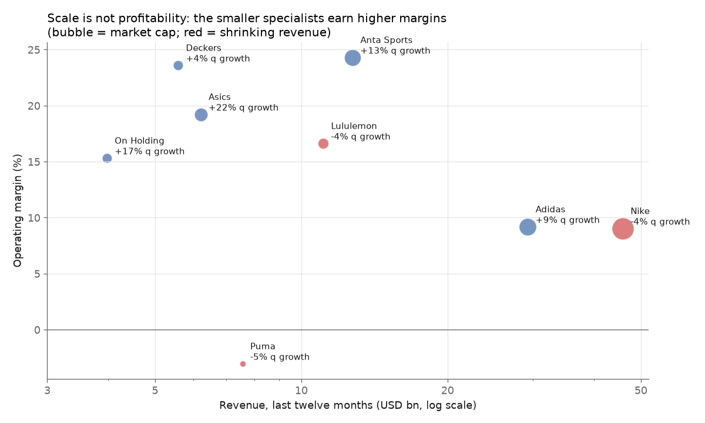
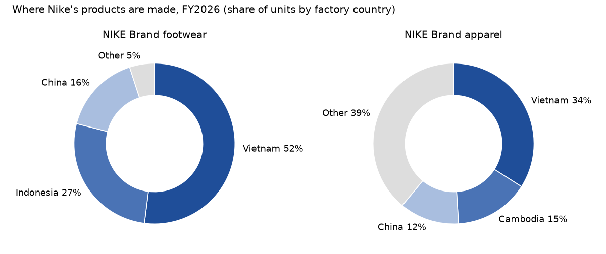

# Industry deep dive: global athletic footwear and apparel

*Educational project, not investment advice. Market data: yfinance snapshot of 19 November 2026
(`data/market_snapshot.json`). Company facts: Nike Form 10-K for FY2026, filed 15 July 2026
(`data/raw/10k/`). Charts are rebuilt by `make build`.*

## 1. Summary

- **The industry is a brand business, not a manufacturing business.** The brands design, market
  and distribute; independent contract factories in Asia make the products. Brands keep gross
  margins of 43% to 67%, so that is where most of the profit is.
- **Scale no longer guarantees the best margins.** Nike and Adidas have more than half of the
  revenue of the eight listed players covered here, but both earn an operating margin of about 9%.
  Specialists such as Deckers (Hoka), Asics and Anta earn 19% to 24%.
- **Running and "performance" products are where share moved.** On, Asics and Hoka grew fast
  while Nike's revenue fell 10% in FY2025. Nike's 10-K shows it is now rebuilding wholesale, the
  channel it cut back during its direct-to-consumer push.
- **Two outside forces set the margin floor: trade policy and China.** About 95% of Nike's
  footwear is made in Vietnam, Indonesia and China. Its Greater China revenue fell 23% in two
  years, while Anta, a local brand, grew.
- **Implication for the Nike pitch.** The industry still pays well for brand strength. Nike's
  problem is execution and product freshness, not industry economics. This supports a margin
  recovery thesis, with the specialists' growth as the main risk.

## 2. Industry definition and size

The segment covered is **branded athletic footwear and apparel**: performance and lifestyle
sneakers, sportswear and equipment sold under a brand. Unbranded and private-label clothing are
excluded.

The eight listed companies below had **about USD 122 billion of combined revenue** over the last
twelve months. Nike alone is 38% of that. The total market is larger: New Balance, Skechers (owned
by 3G Capital since 2025) and Li Ning are not in the peer set, and retailer margins are not counted.

## 3. Value chain and where the money is made

| Link in the chain | What it does | Economics |
|---|---|---|
| Materials and components | Foams, rubber, textiles | Commodity-like; cost pass-through |
| Contract manufacturers | Labour-intensive assembly, concentrated in Southeast Asia | High volume and thin margins. Nike's top 4 footwear suppliers make 60% of its footwear across 95 factories in 11 countries |
| **Brand owner** | Product design, innovation, marketing, demand creation | **Gross margin 43–67% (chart below).** Demand creation alone is 10% of Nike's revenue (USD 4.8bn in FY2026) |
| Wholesale retailers | Reach and shelf space | Retailer margin on top of the brand's price. Concentrated: Nike's top 3 US customers are 29% of its US sales |
| Direct to consumer | Own stores and digital | Brand keeps the full retail margin but pays for stores, logistics and markdowns |

**Where the money is made.** The brand captures the gap between factory cost and retail price,
and it pays for that gap with marketing. The best returns go to the brands that combine three
things:

- a product with a functional reason to buy (running, cushioning);
- pricing power, shown by a high gross margin;
- disciplined demand-creation spending.

Volume alone does not earn them.

Nike's direct-to-consumer shift (FY2020–FY2024) tried to capture the retailer's margin too. It
went too far: it gave shelf space to challengers in wholesale doors. Since then, NIKE Direct
revenue has fallen from USD 21.5bn in FY2024 to USD 17.7bn in FY2026, while wholesale grew 6% in
FY2026.

## 4. Major players

| Company | Ticker | LTM revenue (USD bn) | Revenue growth, latest quarter y/y | Gross margin | Operating margin | Market cap (USD bn) | EV/EBITDA |
|---|---|---:|---:|---:|---:|---:|---:|
| Nike | NKE | 45.9 | -4% | 43% | 9% | 51.0 | 11.0x |
| Adidas | ADS.DE | 29.3 | +9% | 52% | 9% | 31.9 | 11.3x |
| Anta Sports | 2020.HK | 12.8 | +13% | 62% | 24% | 29.2 | 8.1x |
| Lululemon | LULU | 11.1 | -4% | 55% | 17% | 12.2 | 5.4x |
| Puma | PUM.DE | 7.6 | -5% | 47% | -3% | 4.0 | n.m. |
| Asics | 7936.T | 6.2 | +22% | 57% | 19% | 18.9 | 13.3x |
| Deckers (Hoka, UGG) | DECK | 5.6 | +4% | 59% | 24% | 10.5 | 7.1x |
| On Holding | ONON | 4.0 | +17% | 67% | 15% | 10.3 | 13.9x |

Notes: local-currency figures converted to USD at the snapshot exchange rate. EV = market cap +
total debt (including leases) − cash. Puma's LTM EBITDA is negative.

Three groups emerge:

1. **Global scale brands (Nike, Adidas, Puma):** they compete in every category and every region,
   carry the biggest marketing budgets, and are the most exposed to discounting cycles.
2. **Performance specialists (Asics, On, Hoka):** they are winning share in running through product
   innovation. They have a higher gross margin and fast growth, and the market values them on growth.
3. **Regional or category champions (Anta, Lululemon):** Anta is a multi-brand leader in China, and
   Lululemon leads in premium apparel. Both earn high margins, but they depend on one market or one
   category.

## 5. Competition: Porter's five forces

| Force | Intensity | Evidence |
|---|---|---|
| Rivalry among brands | **High** | Share has moved quickly to running specialists, and discounting in FY2025 compressed margins across the group. Puma is loss-making at the operating level |
| Threat of new entrants | **Medium** | Manufacturing is outsourced, so starting a brand is cheap (On was founded in 2010). Scaling it is expensive because it needs athlete marketing, distribution and innovation |
| Bargaining power of buyers (retailers and consumers) | **Medium-high** | Wholesale is concentrated (Nike's top 3 US customers are 29% of its US sales). Consumers switch brands easily, and only "hype" products sell at full price |
| Bargaining power of suppliers | **Low-medium** | Factories depend on a few big brands. However, Nike's sourcing is concentrated too: 4 suppliers make 60% of its footwear, and switching countries takes years |
| Threat of substitutes | **Low-medium** | Non-athletic casual footwear and fast fashion compete for the lifestyle part. Performance products have few substitutes |

**Conclusion.** The industry is attractive for brands with a product edge and hard on brands that
lose it. Profitability is decided at the brand level, not the industry level, which is why margins
range from −3% to 24% within the same industry.

## 6. Regulation and trade

- **Import tariffs.** Footwear and apparel have long carried high US import duties, and US trade
  policy changed sharply in 2025–2026. Nike's FY2026 balance sheet includes a **USD 684m receivable
  for the recovery of import duties**, so tariff decisions now affect cash and margins directly. The
  10-K names tariffs and retaliation as a risk factor.
- **Forced-labour rules.** In the US, the Uyghur Forced Labor Prevention Act (2022) presumes that
  goods with inputs from Xinjiang are made with forced labour. The EU Forced Labour Regulation will
  ban such products from the EU market from December 2027. Brands must be able to trace cotton and
  materials through their supply chains.
- **Sustainability reporting.** EU sustainability-reporting rules (CSRD) and the scrutiny of green
  claims raise the cost of compliance and of marketing for brands with large EU sales. This matters
  for Nike, whose EMEA revenue was USD 12.6bn.

## 7. Trends to watch

| Trend | Winners | Losers |
|---|---|---|
| Performance running boom | On, Asics, Hoka | Brands that relied on lifestyle franchises (Nike's Dunk and Air Force 1 slowed) |
| Return to wholesale after the direct-to-consumer push | Retailers, brands with deep partner relationships | Brands whose own channels are discounting |
| Rise of local brands in China | Anta, Li Ning | Western brands (Nike Greater China −23% in two years) |
| Tariffs and near-shoring | Brands with diversified sourcing and pricing power | Lower-margin brands with sourcing concentrated in China |

## 8. What it means for Nike

Nike still has the industry's largest brand budget and its most profitable segment, North America,
which earned USD 5.4bn EBIT in FY2026. The industry data shows that a gross margin of 45%+ and
double-digit operating margins are normal for brands with product momentum. Nike's FY2026 operating
margin of 8.2% is therefore a company problem, not an industry ceiling. The stock pitch's base case
assumes recovery only to 11.2% by FY2031, below Nike's own FY2022 level and well below the
specialists. The main industry risk is that the running specialists keep taking share faster than
Nike's product pipeline can respond.

## Sources

- Nike, Inc., Form 10-K for the fiscal year ended 31 May 2026, filed 15 July 2026 (SEC EDGAR),
  Items 1 (Business), 1A (Risk Factors) and 7 (MD&A).
- SEC EDGAR XBRL company facts API, Nike (CIK 320187).
- Company market data and last-twelve-month financials: Yahoo Finance via `yfinance`, 19 November 2026.

---

## Résumé en français

Cette étude sectorielle analyse le marché mondial des chaussures et vêtements de sport de marque.
La valeur se crée chez les **propriétaires de marques**, avec des marges brutes de 43 à 67 %. La
fabrication est sous-traitée en Asie (52 % des chaussures Nike sont fabriquées au Vietnam). La taille
ne garantit plus la rentabilité : Nike et Adidas réalisent une marge opérationnelle d'environ 9 %,
contre 19 à 24 % pour des spécialistes comme Asics, Deckers (Hoka) ou Anta. Selon l'analyse des cinq
forces de Porter, la rivalité est forte et le pouvoir des distributeurs important. Les menaces
principales viennent des droits de douane, de la réglementation sur le travail forcé et de la montée
des marques chinoises. Conclusion : la faible marge de Nike reflète un problème d'exécution propre à
l'entreprise, pas un plafond du secteur. Cela soutient la thèse de redressement de la marge présentée
dans le pitch.
